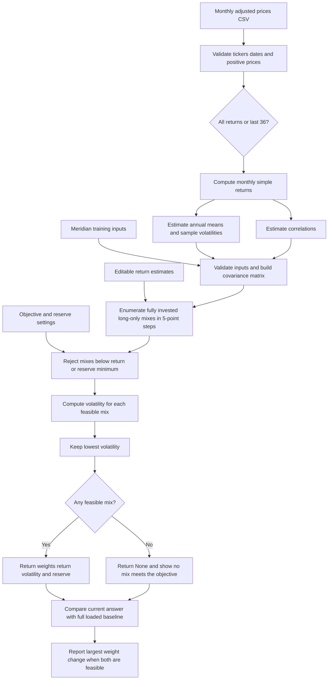

# Lab 15 — Portfolio Stability Decision

Pierce Appleton | October 22, 2026

## Question and decision

Which mix carries the least risk while meeting the mandate, and does it survive a one-point change in one estimate?

**Pilot the all-month mix of 60% BIL and 40% VT as a Project 2 starting allocation.** The last-36-month estimate instead chooses 85% BIL and 15% VT, a **25-percentage-point** shift. Before adoption, require forward-looking return estimates supported independently of this sample, an explicit cost allowance for the net objective, and a defined loss-risk measure and breach response from the client. A change in those assumptions or a failure to meet the unchanged objective would trigger a new allocation review.

The code and calculations are complete. The stress test and code explanation below are written exercises; they do not document a live partner exchange or a completed Brightspace quiz. The paper drawing and no-AI explain-back remain in-person activities.

## Run the app

From the repository root, on Windows:

```powershell
python -m venv .venv
.\.venv\Scripts\python -m pip install -r labs/lab-15/requirements.txt
.\.venv\Scripts\python -m streamlit run labs/lab-15/app.py
```

Select **Use saved Project 2 prices**, or upload [prices.csv](../lab-14/prices.csv). The sidebar starts at objective 6.5% and reserve minimum 3%. BIL and IEF are selected as eligible for the saved universe. Return estimates are editable; the 36-month switch changes both estimated returns and the covariance inputs. Both columns retain the selected mandate settings; the left column always uses the full loaded sample and unedited returns.

```powershell
python labs/lab-14/portfolio.py
python labs/lab-14/verify_labs.py
.\.venv\Scripts\python labs/lab-15/verify_lab15.py
```

## Meridian verification

All calculations come from [portfolio.py](../lab-14/portfolio.py), extended from Lab 14. Its original printed baselines are unchanged. The page imports the engine and reloads it on rerun; it contains no second implementation of the portfolio calculations.

| Run | Bills / 10-year / IG / equity (%) | Return estimate (%) | Volatility (%) | Reserve (%) |
|---|---|---:|---:|---:|
| As loaded | 0 / 20 / 25 / 55 | 6.51 | 9.44 | 20 |
| Equity estimate reduced from 8% to 7% | 0 / 10 / 10 / 80 | 6.53 | 12.94 | 10 |
| IG–equity correlation raised from 0.25 to 0.50 | 0 / 40 / 0 / 60 | 6.52 | 9.73 | 40 |

The one-percentage-point reduction in the equity estimate moves **25 points** into equity. The correlation probe changes both symmetric cells, with the equity estimate restored to 8%. The tests use copies; the saved correlation remains 0.25. Changing the actual engine table and rerunning the page is also checked by the integration test.

## Project 2 universe and mandate

Use the [Lab 13 fictional education-foundation mandate](../lab-13/lab-13-writeup.md): seven-year horizon, annual rebalancing, CPI + 4% net over rolling five years. CPI 2.5% is a modeling estimate, so this lab uses **6.5% expected nominal return**, before an explicit cost allowance. The hard constraint tested here is **at least 3% in BIL or IEF**, with long-only fully invested weights. Other provisions, including turnover, liquidity assessment, net realized performance and future losses, require separate checks.

| Ticker | Fund | Role | Source and download date |
|---|---|---|---|
| BIL | State Street SPDR Bloomberg 1-3 Month T-Bill ETF | Cash / reserve proxy | [Yahoo monthly Adj Close](https://finance.yahoo.com/quote/BIL/history/), 2026-10-20 |
| IEF | iShares 7-10 Year Treasury Bond ETF | Government bonds / reserve proxy | [Yahoo monthly Adj Close](https://finance.yahoo.com/quote/IEF/history/), 2026-10-20 |
| LQD | iShares iBoxx $ Investment Grade Corporate Bond ETF | Investment-grade fixed income | [Yahoo monthly Adj Close](https://finance.yahoo.com/quote/LQD/history/), 2026-10-20 |
| VT | Vanguard Total World Stock Index Fund ETF Shares | Broad global equity | [Yahoo monthly Adj Close](https://finance.yahoo.com/quote/VT/history/), 2026-10-20 |

The existing [price file](../lab-14/prices.csv), [exact endpoint provenance](../lab-14/prices-sources.json) and [downloader](../lab-14/download_prices.py) are reused. There are 60 monthly adjusted prices per fund, October 2021–September 2026; October 2026 is incomplete and excluded. First-of-month dates label monthly observations rather than actual month-end trading days. Adjusted prices reflect distributions and splits and can be revised by the provider. No new download is claimed.

## Historical estimates and window comparison

Monthly simple return = price this month / price previous month − 1. Annual return estimate = mean monthly return × 12. Annual volatility estimate = sample standard deviation × √12. Correlations use the same monthly observations and covariance = correlation × annual volatility × annual volatility. These are historical arithmetic estimates, not forecasts or compound growth rates. Annualizing assumes monthly variance scales linearly with time.

| Asset | All-month return estimate (%) | All-month volatility (%) | Last-36 return estimate (%) | Last-36 volatility (%) |
|---|---:|---:|---:|---:|
| BIL | 3.6574 | 0.4909 | 4.3660 | 0.2135 |
| IEF | −1.7289 | 7.7184 | 3.0696 | 6.6602 |
| LQD | −0.9276 | 9.8686 | 4.8428 | 7.8225 |
| VT | 11.0502 | 14.9240 | 20.2471 | 11.7089 |

| Window | BIL / IEF / LQD / VT (%) | Return estimate (%) | Volatility (%) | Reserve (%) |
|---|---|---:|---:|---:|
| All months: 60 prices, 59 returns | 60 / 0 / 0 / 40 | 6.61 | 6.05 | 60 |
| Last 36 monthly returns: 37 prices | 85 / 0 / 0 / 15 | 6.75 | 1.79 | 85 |

The full price window is October 2021–September 2026; its first return is November 2021. The shorter calculation uses September 2023–September 2026 prices for October 2023–September 2026 returns. **Largest absolute weight change = 25 points**, in both BIL and VT. The objective stays at 6.5%, reserve minimum at 3%; neither is lowered to obtain a feasible result.

The shorter sample assigns VT a much higher return estimate and lower volatility. Less equity is then needed to reach the objective, allowing more BIL and producing a much lower estimated portfolio volatility. This is evidence of sensitivity to sample choice, not proof that the newer allocation has lower future risk.

## Stress test — one-point reduction in the equity estimate

Attack: distrust VT's full-sample 11.0502% annual arithmetic estimate and reduce it by one percentage point to 10.0502%, holding volatilities, correlations and mandate settings fixed.

| Run | BIL / IEF / LQD / VT (%) | Return estimate (%) | Volatility (%) | Reserve (%) |
|---|---|---:|---:|---:|
| Full-sample baseline | 60 / 0 / 0 / 40 | 6.61 | 6.05 | 60 |
| VT estimate −1 percentage point | 55 / 0 / 0 / 45 | 6.53 | 6.79 | 55 |

Two-sentence response: Reducing VT's estimate by one point forces the search to raise VT from 40% to 45% to keep the 6.5% objective, increasing estimated volatility from 6.05% to 6.79%. I would keep the allocation in pilot review until independent expected-return evidence and a cost allowance support the target, because the sample-window change already moves 25 points of capital.

## Engine flowchart



## Explain the search from the code

`search` checks the asset count and mandate inputs, selects reserve-eligible names, and builds covariance once. `best = None` represents no feasible mix yet. `weight_grid` recursively allocates 20 units, each worth 5%, across all assets; the final asset receives the remaining units. This enumerates every grid mix exactly once, with nonnegative weights summing to one.

For each mix, `expected_return` computes the weighted return estimate; the reserve sum counts only eligible names. `continue` discards any allocation missing either minimum. A tolerance of 1e-12 prevents binary floating-point error from rejecting an exact boundary. `portfolio_volatility` applies the full covariance formula only to feasible candidates. The final `if` replaces `best` when risk is lower, retaining the first mix on an exact risk tie. The function returns the best record or `None`. This solves the discrete grid problem, not the unrestricted continuous optimum; a 3% reserve minimum effectively requires at least 5% eligible holdings on this grid.

Code question: **Why can a lower equity return estimate result in more equity?** Because the return floor stays fixed: the old allocation becomes infeasible, and the optimizer must add the high-return asset even though its estimate has fallen. Minimum volatility is evaluated only among the allocations still meeting the floor.

## Estimation risk and self-check

1. **What is estimation risk?** The risk that uncertain means, volatilities and correlations produce an allocation that appears efficient in the model but disappoints outside the sample.
2. **Why can optimization amplify small errors?** The optimizer treats input estimates as exact. A small change can remove the former winner from the feasible set, and the lowest-risk feasible point can jump across a coarse grid; it has no automatic allowance for uncertainty.
3. **How large was the effect here?** Our window change moves 25 points from VT to BIL, whereas a one-point cut to VT's full-sample estimate moves 5 points in the opposite direction. Meridian's one-point equity cut moves 25 points into equity.
4. **Does minimum volatility guarantee a calendar-year loss limit?** No. Standard deviation does not bound future losses, and the mandate's S9 needs an operational risk measure and response.
5. **What if the objective becomes infeasible?** Report “no mix meets the objective”; do not silently lower the objective or reserve rule.
6. **Why use adjusted prices?** Unadjusted prices omit the effect of distributions and splits on investor returns.
7. **What must change before adoption?** The client must clarify loss governance and costs, and the allocation must survive defensible forward estimates and additional sample and stress checks.

These are practice questions drawn from the lab, not answers to an accessed Brightspace attempt. No quiz submission is claimed.

## Verification and checkout

The verification scripts cover the three Meridian known answers, the unchanged Lab 13/14 checks, infeasible targets, reserve eligibility, CSV validation, both actual-price windows, and page interactions. The Streamlit test edits the equity input, switches to saved prices and then to 36 returns. The engine mutation check verifies the page follows the actual saved correlation table and restores it afterward.

- [Writeup](https://github.com/pierceappleton/FIN439-Labs/blob/main/labs/lab-15/lab-15-writeup.md)
- [Streamlit app](https://github.com/pierceappleton/FIN439-Labs/blob/main/labs/lab-15/app.py)
- [Shared engine](https://github.com/pierceappleton/FIN439-Labs/blob/main/labs/lab-14/portfolio.py)
- [Verification](https://github.com/pierceappleton/FIN439-Labs/blob/main/labs/lab-15/verify_lab15.py)
- [Requirements](https://github.com/pierceappleton/FIN439-Labs/blob/main/labs/lab-15/requirements.txt)
- [Prices](https://github.com/pierceappleton/FIN439-Labs/blob/main/labs/lab-14/prices.csv)
- [Exact price sources](https://github.com/pierceappleton/FIN439-Labs/blob/main/labs/lab-14/prices-sources.json)
- [Course instruction](https://github.com/CinderZhang/FIN43900-Fall2026/blob/main/lessons/week-09/lab-15-portfolio-stability.md)
